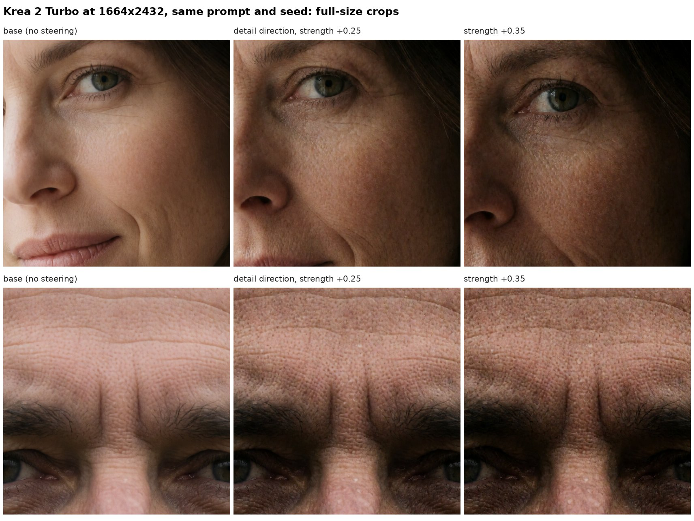
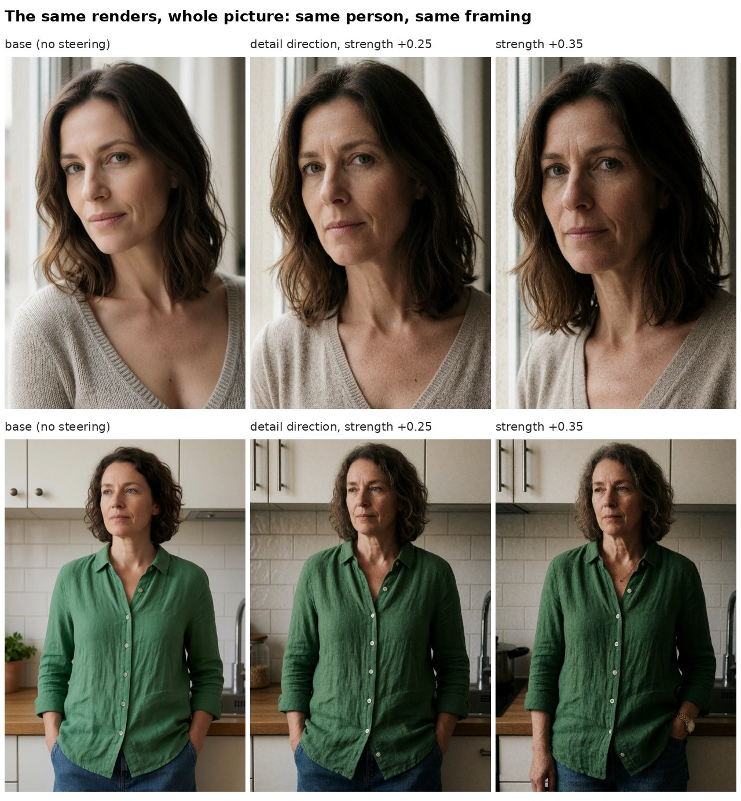
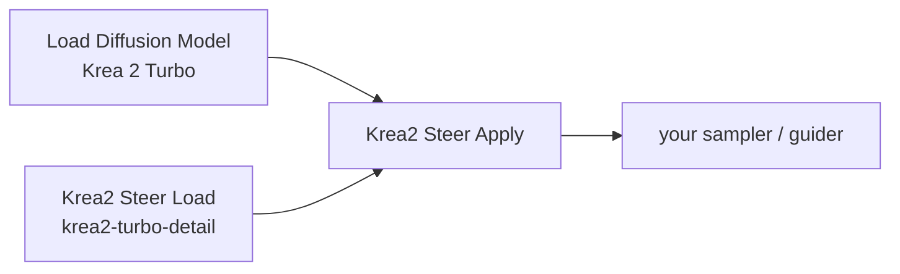
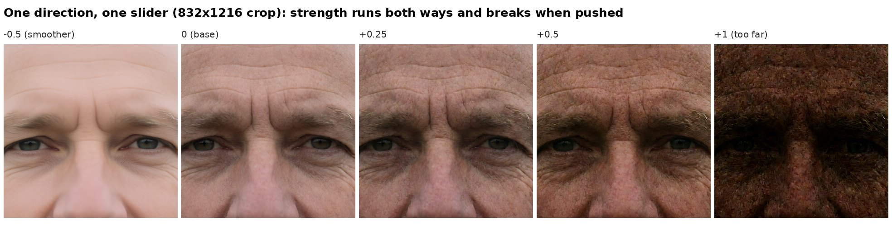
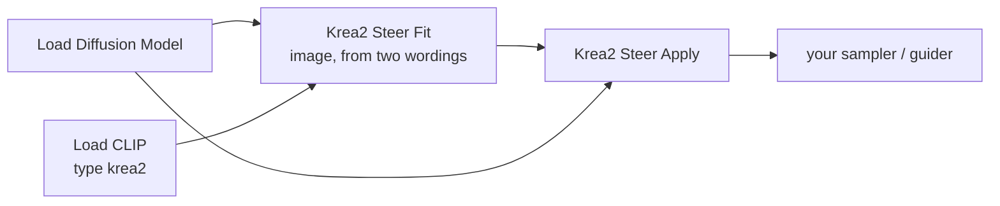
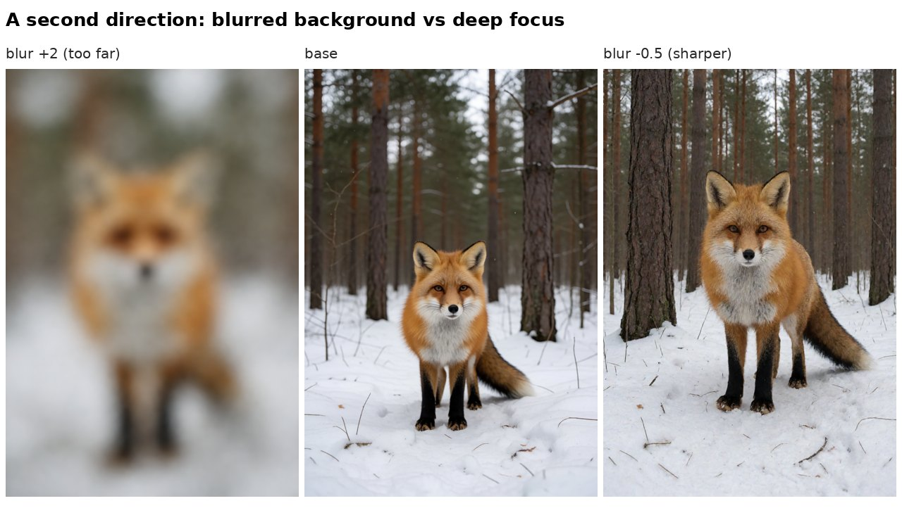

# ComfyUI-Krea2-Steer

**Steer Krea 2 at inference time. No training, no LoRA, one small file per direction.**

A direction is a slider. Push it one way and every picture leans toward a look; push it the other way and it leans
away. Negative strength works like a negative prompt, which Krea 2 Turbo does not otherwise have at CFG 1.



Same prompt, same seed, Krea 2 Turbo at 1664x2432. The only change is one direction ("detail") at a small
strength. The smooth, airbrushed skin of the base render gets its pores back.



It is the same person in the same framing. This is not a different prompt or a different seed. Note the side effect:
the steered pictures are darker and a little harsher. That is discussed under [Limits](#limits-and-open-questions).

> **Status: early.** Measured on Krea 2 Turbo (BF16), 8 steps, euler/simple, four test prompts, one seed. Treat the
> numbers as a starting point, not as proof. Issues and counter-examples are welcome.

---

## Use it in five minutes

**1. Install**

```
cd ComfyUI/custom_nodes
git clone https://github.com/Atlas3DSS/ComfyUI-Krea2-Steer
```

No extra Python packages. Restart ComfyUI. The nodes are under **Krea2/steer**.

**2. Add two nodes to your usual Krea 2 Turbo workflow**



- **Krea2 Steer Load**: pick `krea2-turbo-detail.safetensors` (it ships with this pack).
- **Krea2 Steer Apply**: put it between your model loader (after any LoRAs) and the sampler.

**3. Set the strength**

On **Krea2 Steer Apply** set `image_strength` to **0.25** and leave everything else alone. Render. Compare with
`image_strength` 0 on the same seed.

| `image_strength` with `krea2-turbo-detail` | What you get |
| --- | --- |
| -0.5 | smoother than normal |
| 0 | the normal render |
| +0.15 to +0.35 | more fine detail: pores, fabric weave, fur |
| +0.5 | a lot more, darker, the face starts to change |
| +1 | too far: dark and noisy |



That is all you need to use a ready-made direction. `examples/workflow-api.json` is a complete graph in ComfyUI's API
format (drag it into ComfyUI or post it to `/prompt`).

---

## Make your own direction

You describe a look and its opposite in words. The pack measures the difference inside the model.



1. Add **Krea2 Steer Fit (image, from two wordings)**. Connect your model and CLIP.
2. `toward`: one or two sentences describing the look. Example: `Shallow depth of field, the background blurred into soft bokeh.`
3. `away`: the opposite. Example: `Deep focus, everything sharp from front to back.`
4. Leave `scenes` as it is (24 everyday scenes). Set `steps` to the step count you render with.
5. `save_as`: a name, for example `my-blur`. Run once. It takes a few minutes: the node renders every scene twice.
6. From then on use **Krea2 Steer Load** with your saved file instead of fitting again.

Positive strength moves toward `toward`, negative toward `away`.



**Tips for wording**

- Fill in both sides. A contrast is cleaner than one side alone.
- Say only what you mean. A direction carries everything the words imply: "raw photograph" also brightens and adds
  grain, "crisp micro-detail" also darkens. Narrow wording, low strength.
- Start at 0.25 and sweep. Strength 1 means "the whole measured difference" and is usually far too much for the image part.

---

## How it works

A steering direction is a **mean difference**. Run the model on the same everyday scenes under two conditions, average
what the model holds internally in each, subtract. Add that one constant vector back in while rendering and every
picture leans the same way. The idea comes from a community recipe for SDXS-512 that edits 768 numbers (the final bias
of CLIP). Krea 2 is built differently, so the same logic goes in at different places:

```
prompt -> Qwen3-VL (12 hidden layers) -> txtfusion -> txtmlp -> text tokens (6144 wide)
                                                         ^
                                                         TEXT PART: the bias of txtmlp.3 (one vector)

[text tokens + image tokens] -> block 0 -> block 1 -> ... -> block 27 -> picture
                                  ^          ^                 ^
                                  IMAGE PART: one vector per block and per noise level, added to the image tokens
```

| Part | What is patched | Size | Cost | Character |
| --- | --- | --- | --- | --- |
| Text | bias of `txtmlp.3`, the last layer every text token passes | 6,144 numbers | none (a weight patch) | gentle, keeps the subject; exports as a plain LoRA |
| Image | image tokens leaving each transformer block | 8 noise levels x 28 blocks x 6,144 (5.5 MB) | a few additions per step | strong; global look, detail, focus, tone; can act on some steps or blocks only |

**What did not work**, so nobody repeats it: adding the vector to the raw encoder output (the 12-layer stack, before
`txtfusion`). Up to 2x it does nothing; at 8x the subject is gone.

## All the nodes

| Node | Does |
| --- | --- |
| **Krea2 Steer Load** | Loads a saved direction (your own in `models/krea2_steer/`, or the ones shipped in `directions/`). |
| **Krea2 Steer Apply** | Patches the model. `text_strength`, `image_strength`, a block range and a noise window for the image part. Chain several for several directions. |
| **Krea2 Steer Fit (image, from two wordings)** | Renders each scene both ways with the same noise and averages how the image tokens differ. Minutes. |
| **Krea2 Steer Fit (text, from two wordings)** | Averages how the text tokens differ between the two wordings. Seconds. |
| **Krea2 Steer Fit (image, from two picture sets)** | The same without words: two batches of pictures, for example real photographs against the model's own renders. Written, not yet evaluated. |
| **Krea2 Steer Export LoRA (text part)** | Writes the text part as a bias-only LoRA any LoRA loader applies, no custom node needed. |

**Apply, in detail**

| Input | Meaning | Start with |
| --- | --- | --- |
| `image_strength` | how far to move inside the image model | -0.25 / +0.25 |
| `text_strength` | how far to move the text the model reads | 2 to 4 |
| `first_block`, `last_block` | which of the 28 blocks the image part acts on | 0 and 27 |
| `start_sigma`, `end_sigma` | the noise window: 1 is the first step, 0 the finished picture. `start_sigma` 0.6 = late steps only, which changes texture and leaves layout alone | 1.0 and 0.0 |

## Measured so far (Krea 2 Turbo)

Fine-detail contrast of a face crop (higher = more pixel-scale texture), `krea2-turbo-detail`, image part:

| Strength | -0.5 | 0 (base) | +0.25 | +0.5 | +1 |
| --- | --- | --- | --- | --- | --- |
| woman, close-up, 832x1216 | 4.4 | 6.5 | 7.4 | 9.0 | 11.3 |
| man, close-up, 832x1216 | 5.0 | 8.1 | 10.0 | 12.7 | 15.5 |

At 1664x2432 (direction fitted at 768x1024): woman 5.8, 6.5, 6.9 and man 5.7, 7.5, 8.7 for base, +0.25, +0.35.
The number rises with noise as well as with real texture, so always look at the crops.

| Setting | Useful range | Past it |
| --- | --- | --- |
| image part, any direction tried | 0.15 to 0.5 | 1 to 2 wrecks the picture |
| image part, late steps only (`start_sigma` 0.6) | up to about 1: texture changes, layout does not | 2 is visible grain |
| text part | -4 to +4 | 8 changes the subject |

## Limits and open questions

- **One model so far.** Fitted and tested on Krea 2 Turbo only. A direction belongs to the weights it was fitted on;
  whether it transfers to finetunes is untested.
- **Directions are not pure.** The detail direction also darkens and adds contrast, and faces read a little older.
  Removing that side effect is the next piece of work.
- **One vector for the whole picture.** The image part shifts every image token alike. It moves global properties; it
  cannot say "only the face".
- **Fit and render alike.** The image part is stored per noise level. Use the step count and scheduler you fitted with.
- **Small sample.** Four prompts and one seed per test.
- **Other models.** The image part only needs transformer blocks that pass a token stream along, which every DiT has,
  image or video. The text part needs that model's own last text layer. Neither has been tried outside Krea 2.
  `AGENTS.md` lists the three places to change.

## Test a direction properly

```
python tools/lab.py examples/plan-detail.json out/detail --server http://127.0.0.1:8188
```

Every arm renders every test prompt with the same seed, so rows differ only by the steering. It writes
`sheet-whole.jpg`, `sheet-crop.jpg` (full-size crops) and `detail.json`. The images on this page were made with it.
`python -m pytest` runs the unit tests (torch only, no GPU).

Agents: read [AGENTS.md](AGENTS.md) for the exact node inputs and the file format.

## Files

| Path | Holds |
| --- | --- |
| `steer.py` | all the maths and model hooks (imports only torch) |
| `nodes.py` | the ComfyUI nodes |
| `directions/` | ready-made directions for stock Krea 2 Turbo: `detail` (positive = more fine detail, negative = smoother), `blur` (positive = softer background, negative = sharper) |
| `tools/lab.py`, `examples/` | fixed-seed comparison sheets, test plans, one API workflow |
| `tests/` | unit tests |

## Licence

MIT, see [LICENSE](LICENSE). The pictures on this page are renders made for this repository.
